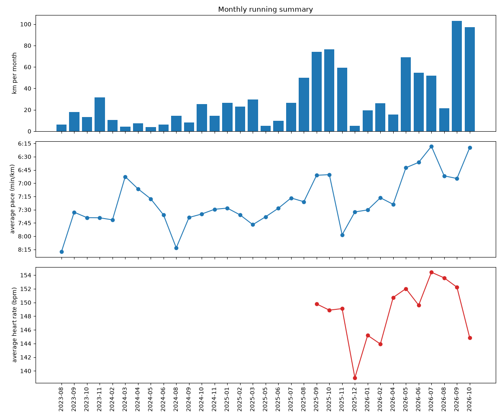

# Strava Running Analysis

I am an enthusiast runner, and this is my first attempt to get better by using the data from my runs.

The script reads my exported Strava activities and shows how my running changes month by month:

- total distance (km)
- average pace (min/km)
- average heart rate (bpm)

It prints a table in the terminal and saves a chart as `running_summary.png`.

## What you need

- Python 3
- A Strava data export (`activities.csv`)
- The `matplotlib` package (the rest uses the Python standard library)

## Setup

### 1. Get your data from Strava

1. On the Strava website, go to **Settings → My Account → Download or Delete Your Account → Get Started**.
2. Click **Request Your Archive**. Strava sends you an email with a zip file.
3. Unzip it and copy `activities.csv` into this project folder.

### 2. Create a virtual environment

```bash
cd ~/strava_data
python3 -m venv venv
source venv/bin/activate
```

Your prompt should now start with `(venv)`. Run `source venv/bin/activate` again each time you open a new terminal.

If `venv` fails on Debian or Ubuntu, run `sudo apt install python3-full` first.

### 3. Install the package

```bash
pip install matplotlib
```

## Run it

```bash
python analysis.py
```

You will see a monthly table like this:

```
month          km  pace/km  avg HR
2026-08      96.4     5:38     151
2026-09     110.2     5:31     149
```

and a new file, `running_summary.png`, with three charts: distance, pace and heart rate.

## My plots



The image above is created by the script. Run `python analysis.py` once so that `running_summary.png` exists in the same folder as this README. Each time you run the script, the image is replaced with an updated version.

## Race time predictions

`predict_race_times.py` estimates my finish time for 5K, 10K, half marathon, 30K and marathon from my recent runs:

```bash
python predict_race_times.py
```

It uses the Riegel formula (`T2 = T1 × (D2 / D1) ^ 1.06`) on runs from the last 120 days. It shows two estimates per distance:

- **Best case**: my strongest recent run, scaled to the race distance
- **Likely**: the average of my 3 strongest runs

The settings at the top of the file (number of days, Riegel exponent, minimum run length) can be changed. These are only estimates, because race results also depend on training for the distance, hills, weather and pacing.

## Deeper analysis of single runs (GPX / FIT files)

`analyze_tracks.py` looks inside each run, using the `.gpx` / `.fit.gz` files from the Strava export (the `activities/` folder). It needs two more packages:

```bash
pip install fitparse folium
python analyze_tracks.py
```

It shows:

- **Best efforts**: my fastest 1 km, 1 mile, 5 km, 10 km and half marathon _inside_ any run, even when I did not run it as a separate race
- **Pacing**: how often I run negative splits (faster second half)
- **Heart rate drift**: how much my heart rate rises relative to my speed during long runs (under about 5% is good)
- **Heart rate zones**: how much time I spend easy vs hard (a common guideline is about 80% easy)

It also saves `track_analysis.png` (charts), `routes.png` (all my routes drawn on a dark background, no map provider needed) and `routes_map.html` (the same routes on an interactive map).

The script looks for `activities.csv` and the `activities/` folder in the folder where the script itself is saved, no matter where it is started from. If the data is somewhere else, set `DATA_FOLDER` at the top of the file. All results (`track_analysis.png`, `routes_map.html`, `track_cache.pkl`) are saved in that folder too.

Before running it, set `MAX_HR` at the top of the file to my own maximum heart rate. The first run can take a few minutes because every file is read. After that, the results are saved in `track_cache.pkl`, so later runs take seconds. To test quickly, set `MAX_FILES = 50`.

**Street map and API key:** since September 2026 the CARTO map tiles need a free API key, and OpenStreetMap's own server blocks maps opened from a file. To get street names in `routes_map.html`:

1. Request a key at <https://carto.com/basemaps/apikey> (free, no account; choose non-commercial use)
2. Paste it into `CARTO_API_KEY` at the top of `analyze_tracks.py`, or set it as the `CARTO_API_KEY` environment variable
3. Do not add website restrictions to the key, because a page opened from a file sends no referrer and would be refused

Without a key, the map falls back to Esri satellite imagery, and `routes.png` always works.

**Privacy:** `routes.png`, `routes_map.html` (which also contains the API key) and the GPX/FIT files show where I live and run. Do not upload them to GitHub or share them publicly. Keep the key out of anything I upload.

## React web page with a "Reload data" button

The React app shows my stats, race predictions and charts. A browser cannot run Python, so Python and React pass data through files:

- `export_for_web.py` writes `public/data/runs.json` and copies the chart images into the React project
- `server.py` is a small local server (standard library only) that runs my scripts when I press the button

**One-time setup**

1. Set `REACT_PROJECT` at the top of `server.py` (and `export_for_web.py`) to the folder of my React app (the one with `package.json`)
2. Check the file names in `STEPS` at the top of `server.py`. They run in this order: `strava.py` (monthly charts), `gpx.py` (track analysis), `export_for_web.py`. A file that does not exist is skipped
3. In the React project, add a proxy to `vite.config.js` so that `/api` requests go to the Python server, then restart `npm run dev`:

```js
export default defineConfig({
  plugins: [react()],
  server: {
    proxy: { "/api": "http://127.0.0.1:5050" },
  },
});
```

**Every time**

```bash
# terminal 1, in the Strava folder (venv active)
python server.py

# terminal 2, in the React project
npm run dev
```

Open the address that `npm run dev` prints, then press **Reload data**. The page shows each Python step while it runs and loads the new numbers when it is finished. The first run can take a few minutes because every GPX/FIT file is read. After that the cache makes it fast.

The server only listens on my own computer (127.0.0.1) and only runs the scripts listed in `STEPS`.

## How to read the results

- **Pace** is total time divided by total distance for the month, so long runs count more than short ones. The pace axis is flipped, so a line going up means you are getting faster.
- **Heart rate** is averaged only over runs that have heart rate data, weighted by time.
- If your pace gets faster while your heart rate stays the same or drops, that is a rough sign your fitness is improving. Heat, hills and the mix of easy runs and workouts also affect these numbers.

## Troubleshooting

| Problem                                          | Fix                                                                                                                        |
| ------------------------------------------------ | -------------------------------------------------------------------------------------------------------------------------- |
| `externally-managed-environment` when installing | Use the virtual environment from step 2                                                                                    |
| `ValueError: ... is not in list`                 | Column names differ in your export. Add `print(headers)` after `headers = next(reader)` and adjust the names in the script |
| `Unsupported activity date`                      | Your date format is different. Add it to the list of formats in `parse_date`                                               |
| No chart window appears                          | The chart is saved as `running_summary.png`, so open that file                                                             |

## Ideas for next steps

- Weekly instead of monthly view
- Compare years
- Include trail runs (`Trail Run` activity type)
- Look at single runs (splits, heart rate drift) using the GPX/FIT files from the export
